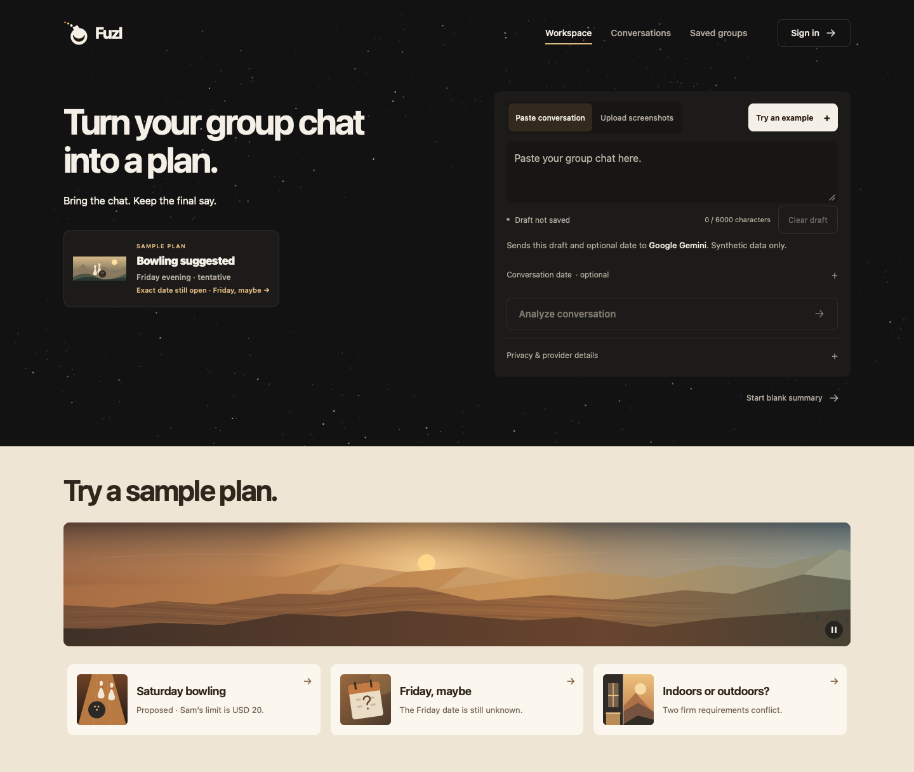

# Fuzl

Turn a group conversation into an outing people can agree on. Fuzl helps an organizer review what friends want, compare ideas against the group's constraints, collect votes, and publish a plan with RSVPs.



## How it works

1. **Bring the conversation.** Paste selected messages, review a screenshot transcript, or discuss an outing in a saved group's Fuzl conversation.
2. **Review the Plan.** Correct people, dates, budgets and preferences. Unknowns, tentative claims, conflicts and supporting excerpts stay visible. AI output needs explicit acceptance.
3. **Compare and shortlist.** Evaluate general ideas, saved ideas, places or scheduled events against the current attendees' constraints. Keep up to three options; missing evidence remains **Needs checking**.
4. **Vote, then decide.** Publish a versioned ballot for account-free voting. The organizer explicitly selects and confirms the final plan; votes do not imply attendance.
5. **Share and RSVP.** Publish the shared plan and collect Going/Maybe/Can't make it responses. Material changes can require reconfirmation. Completed outings and approved group takeaways can inform later planning.

These flows are implemented and covered by synthetic tests and disposable-database checks. Hosted end-to-end acceptance is still pending; implementation does not mean a booking, ticket, venue detail or person's attendance has been verified.

## Try it locally

Requires **Node 24.18+ within 24.x** and **npm 11.x**. The repository records the versions it was checked with in `package.json`. No provider key, account or PostgreSQL connection is needed for offline samples.

```sh
npm ci
# Copy only if you do not already have this file. Preserve existing settings.
cp -n apps/api/.env.example apps/api/.env
npm run dev
```

Open **http://127.0.0.1:5173/** on the Mac running Fuzl. The API listens on **127.0.0.1:3001**, with `/api` proxied through Vite. **Try an example** and the gallery's **Saturday bowling**, **Friday, maybe** and **Indoors or outdoors?** open manually authored summaries without an AI request. Replacement prompts protect an existing draft.

For an offline group-conversation demo, open **http://127.0.0.1:5173/?design=chat**. Its fixture controls switch simulated people and exercise planning, shortlisting, voting and RSVPs. It does not send messages to a hosted group or call Gemini.

A same-network preview can be started separately with:

```sh
npm run dev --workspace @fuzl/web -- --host 0.0.0.0 --port 5174
```

Open `http://YOUR_MAC_LAN_IP:5174/` on the same network. AI/private local endpoints intentionally reject LAN origins. Use loopback on the Mac for those actions; drafts do not transfer between addresses. This is a local development preview, not a deployment.

## Optional integrations

Edit **apps/api/.env privately**, preserving existing values. Restart the API after configuration changes. All optional live features are disabled in the safe example file.

| Capability | Backend settings | Guide |
| --- | --- | --- |
| Pasted-text AI extraction | `AI_ENABLED=true`, `AI_PROVIDER=openai` + `OPENAI_API_KEY`, or `AI_PROVIDER=gemini` + `GEMINI_API_KEY` | [AI integration](docs/AI_INTEGRATION.md), [Gemini setup and unpaid-service handling](docs/GEMINI_SETUP.md) |
| Screenshot transcription and planning choices | Selected Gemini configuration above; separate deliberate actions | [Screenshots](docs/SCREENSHOTS.md) |
| Organizer accounts and explicit saving | `SUPABASE_URL`, `SUPABASE_PUBLISHABLE_KEY`, `DATABASE_URL`, optional `DIRECT_URL`, `APP_ORIGIN=http://127.0.0.1:5173` | [Accounts, magic links, TLS and migrations](docs/ACCOUNTS.md) |
| Native group conversations | Account/database setup and current migrations; Gemini only for explicit AI planning | [Conversations and fixture walkthrough](docs/CONVERSATIONS.md) |
| Places | `VENUE_SEARCH_ENABLED=true`, `GEOAPIFY_API_KEY` | [Places setup](docs/PLACES.md), [location resolution and evidence](docs/PLACES_7B.md) |
| Scheduled events | Places/location setup, `EVENT_SEARCH_ENABLED=true`, `TICKETMASTER_API_KEY` | [Events setup and limits](docs/EVENTS.md) |

Configure only the selected AI provider's credentials. There is no automatic paid fallback. Verify project quotas and applicable data handling before an explicit live request. No billing or SMTP setup is required for the offline demo. Supabase development sender restrictions and the pending email task are documented in the account guide.

For persistent features, follow the database/TLS guide before running `npm run db:migrate`. This applies existing migrations with `prisma migrate deploy`; it does not reset a database. Some later feature migrations have only been verified locally—check [progress](docs/PROGRESS.md) before hosted rollout. Never use hosted data for disposable tests.

## Architecture and data

- **Frontend:** React 19, TypeScript and Vite 8 in `apps/web`. Temporary workspace state, review/edit screens, native conversations and credential-scoped public pages share planning contracts. Development demos load separately from the production entry; guest entry screens load on demand.
- **API:** Express 5 in `apps/api`. Provider adapters, validation, request bounds and server-side fit checks sit behind the relevant local-origin, identity, membership and ownership checks.
- **Contracts:** `packages/planning` holds Zod schemas, source checks, uncertainty/status rules, fit/ranking and privacy projections. Firm constraints take precedence over preferences or approved memory.
- **Persistence:** Supabase email magic-link Auth and PostgreSQL, accessed by Prisma 7 on the backend. Guest credentials grant scoped access; a matching display name grants no permissions.
- **Providers:** One selected OpenAI/Gemini extraction adapter; Gemini for the implemented screenshot/native planning actions; Geoapify for area/place discovery; Ticketmaster for scheduled event listings. Results are proposals or provider evidence, not confirmed reservations.

Raw pasted drafts, temporary screenshots and imported transcripts stay in local application memory. Reloading clears them. Explicit saving stores the summary and supporting excerpts, plus the selected planning records. Native Fuzl conversations intentionally store their messages separately under membership checks. Account switches clear private client state. Organizer authentication and guest credentials use the existing dedicated browser storage; raw imports are not added there.

An explicit Analyze action sends the draft and optional reference date to the selected backend AI provider. Read screenshots sends the selected images to Gemini. Planning choices/native-chat extraction send their documented eligible context; raw imports and private answers stay outside native shared context. Place/event providers receive discovery inputs such as area, radius and dates, not conversations, participant records or private budgets. Public ballots/plans expose approved fields and a guest's own response. Each sending action provides a concise disclosure and full **Privacy & provider details** before submission. Provider retention is separate from Fuzl's temporary state; unpaid Google content may be used for improvement and human review. Use synthetic data for development.

Keys and database connections remain backend-only. Keep `.env`, tokens and private certificates out of Git, screenshots and logs. The Supabase project URL and publishable key are intentionally public; database credentials are not.

## Development and verification

```sh
npm test             # Offline API/unit/DOM fixtures; database-only cases skip
npm run test:db      # Owned disposable PostgreSQL; needs initdb, pg_ctl, psql
npm run typecheck
npm run lint
npm run build
```

`npm run dev:web` and `npm run dev:api` start services separately. Installation/build generates Prisma without connecting to a database. Production builds go into workspace `dist` directories; `npm run start:api` starts the compiled API. Hosting and production routing are not configured by these commands.

[Browser setup](docs/BROWSER_SETUP.md) documents the project **fuzl_playwright** MCP connection, isolated Chrome, screenshots and console/network inspection. Keep test evidence under ignored `artifacts/`. [Repository guidance](AGENTS.md) maps entry points and development safeguards.

Useful development-only previews: `?design=chat`, `places`, `ballots`, `plans`, `outings`, `history`, `ideas`, `discovery`, `participation`, `travel`, `backups`, `adjustments`, `people`, `signin`, `logos`, and `health`. These preserve synthetic fixtures and design/diagnostic tools; production does not enable these fixture routes.

## Current status

Section 12B fixed HTTP LAN sample crashes, added visible rendering recovery and retained drafts across navigation. Its [verification report](docs/WEBSITE_12B.md) separates real Chrome/WebKit checks from mocked AI responses. Section 12C's [cleanup report](docs/CLEANUP_12C.md) records the current checks and bundle measurements.

Real Safari, physical phones and hosted account/guest acceptance remain pending. Hosted callback, save/reopen, two-account isolation, guest voting/RSVP and native-conversation rollout need their controlled checks before sharing real plans. WebKit is not Safari; fixture and disposable-database tests do not establish hosted verification. Some live provider connections were tested in earlier passes, with dated evidence in their guides; this cleanup makes no new live requests.

**Section 12D email setup is next.** Reviews/trend discovery, automated booking and deployment remain outside this pass. [Progress](docs/PROGRESS.md) records the implemented milestones and remaining gaps; the original [specification](FUZL_CODEX_SPEC.md) remains unchanged.
